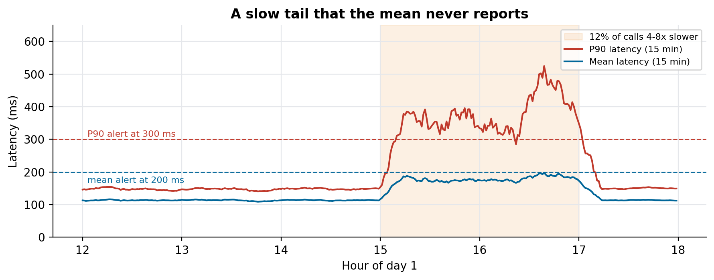
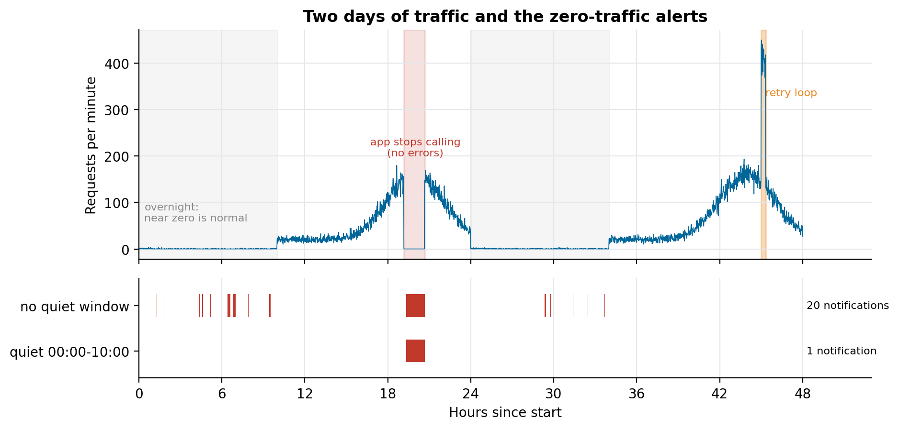

# ML endpoint alerting

Alert rules for ML endpoints as JSON, evaluated minute by minute against two synthetic days with a slow tail, a silent zero-traffic drop and a retry storm.

Companion code for the article **[How to monitor ML models in production](https://lucas.rangeltech.net/articles/h3-monitor-ml-models-in-production/)**.

## The problem

The worst failure of a model in production makes no noise: the endpoint is healthy and nobody calls it, or one call in eight gets slow and the average barely moves.

This repository keeps the alert rules as code and evaluates them against two synthetic days of traffic for one endpoint that follows opening hours, with three planted incidents: a slow tail (12% of calls 4 to 8 times slower), a 90-minute silent drop in traffic, and a 20-minute retry storm.

> All data in this repository is synthetic, generated by the scripts with a fixed seed, with the shape of a real client problem. No client data, names or code are included.

## What the code does

Each rule in `rules.json` has a metric (`p90_ms`, `mean_ms` or `rpm`), an aggregation window in minutes, an operator, a threshold, and an optional quiet window that suppresses notifications during part of the day (the equivalent of an alert processing rule in Azure Monitor). `simulate.py` evaluates every rule at every minute and prints when each one fires.

## Results

| Rule | What happened |
|---|---|
| mean latency > 200 ms | never fired during the slow tail; fired once overnight on a single slow call |
| P90 latency > 300 ms | fired about 10 minutes into the slow tail, for its whole duration |
| RPM > 300 | fired for the retry storm |
| RPM == 0, no quiet window | 20 notifications in two days, 19 of them normal overnight silence |
| RPM == 0, quiet 00:00 to 10:00 | 1 notification: the real 90-minute drop |





## Run it

Python 3.11 or later.

```bash
pip install -r requirements.txt
python simulate.py
python figures.py figures
```

## Files

| File | What it is |
|---|---|
| `rules.json` | the alert rules; edit to try other windows and thresholds |
| `simulate.py` | traffic generator and rule evaluator; writes `results.json` |
| `figures.py` | mean against P90, and the zero-traffic rule with and without a quiet window |

## License

Apache 2.0. See [LICENSE](LICENSE).
